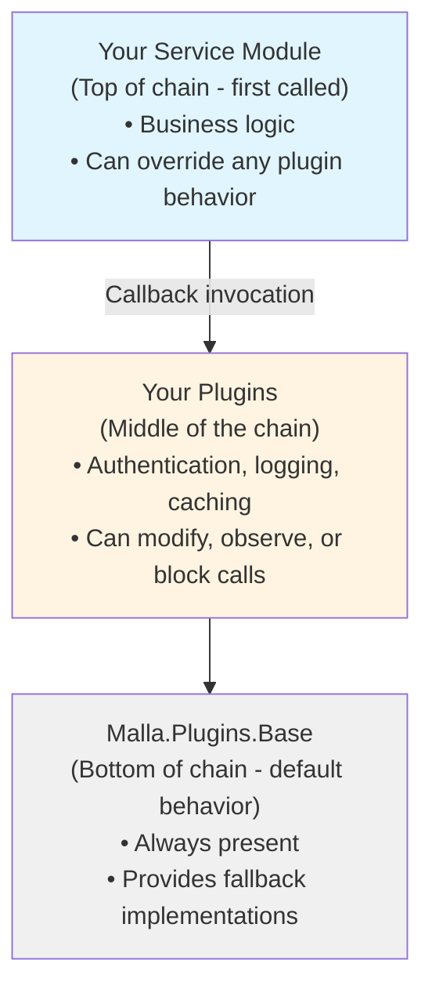

# Introduction to Malla

Malla is a framework for developing **distributed services** in Elixir. A service is a module whose behavior is composed from **plugins** through callback chains that are resolved at compile time. Services running on different Erlang nodes **discover** each other and can call each other. The framework tries to keep the moving parts few and visible.

## Not Just for Distributed Systems

You don't need a cluster to benefit from Malla. On a single node, Malla gives you a plugin-based service architecture with compile-time callback chaining, plugins that can be added, removed and reconfigured while the service runs, a service lifecycle (admin and running statuses, readiness, drain), and an instrumentation API. Distribution is there when you need it.

## Why Malla?

Developing distributed services involves a lot of boilerplate: lifecycle management, configuration, discovery of the other nodes, error normalization. Malla handles part of it, and leaves you free to use any library: it does not enforce constraints on the rest of your code.

Malla is built on production experience running distributed systems in Elixir.

### Key Principles

- **Simplicity and readability.** Plugins are ordinary modules with ordinary functions, and each plugin is meant to handle one concern. Which module implements a callback is decided at compile time and can be inspected (`MyService.service().plugin_chain`), so there is no runtime lookup to reason about.
- **Evolution through plugins.** Add behavior or modify it without touching existing code. Plugins compose, following the [Open/Closed Principle](https://en.wikipedia.org/wiki/Open%E2%80%93closed_principle). A plugin can be removed from a running service, which takes effect for the next call without restarting the service.
- **No lock-in.** All the plugins that come with Malla are optional, and Malla does not require anything of the code around it. You can use it for only part of your system, starting with a single service and expanding gradually.

### Core Features

- **Plugin-based architecture**: behavior is composed through plugins with compile-time callback chaining. The chain is resolved into direct function calls: each hop costs a function call and a `case` on the result, and chains of three or more modules walk a list with `apply/3`. Overhead is low and nothing is looked up at runtime to find who implements a callback. Plugins can be **added and removed at runtime**; the dispatch module is then recompiled.
- **Service discovery**: services declared with `global: true` are announced to the cluster, and each node keeps the list of nodes running each service.
- **Remote calls**: call service functions on remote nodes with `Malla.remote/4`, the `Malla.call` macro or, for callbacks, as if the service module were local (virtual modules).
- **Service lifecycle**: control the service with admin statuses (`:active`, `:pause`, `:inactive`) and follow its running status.
- **Runtime reconfiguration**: change configuration and plugins in a running service.

### Optional Included Utilities

- **Status and error management** (`Malla.Status`, `Malla.Plugins.Status`): turn the values your code returns into standardized, safe-to-expose statuses.
- **Request protocol** (`Malla.Request`, `Malla.Plugins.Request`): remote calls with trace propagation, response normalization and interception on the called side.
- **Tracing and logging** (`Malla.Tracer`): an instrumentation API. Without a tracer plugin the default implementation logs through `Logger` and emits two `:telemetry` counters per span; real tracing needs a plugin that implements the `malla_span*` callbacks. Only log calls below the compile-time `log_min_level` are removed from the code.
- **Process registry** (`Malla.Registry`) and a **node-wide key-value store** (`Malla.Config`).
- **Per-service ETS storage**.
- **HTTP admin server** (`Malla.Plugins.Httpd`) with Kubernetes probes.

## Architecture Overview

### Plugin System

Malla's architecture centers on a plugin system where behavior is composed through callback chains resolved at compile time:

Key characteristics:
- Service modules (using `Malla.Service`) are themselves plugins.
- Dependencies form a hierarchy: `Malla.Plugins.Base` (bottom) → plugins → your service module (top).
- Each callback invocation walks the chain from top to bottom, as long as each module returns `:cont` (or `{:cont, ...}`). The first module that returns anything else ends the call and its value goes to the caller.
- The chains are resolved at compile time. They are rebuilt only when plugins are added or removed at runtime.

### Distributed Services

Services marked as `global: true`:
- Join a cluster-wide process group (`:pg`).
- Are announced to the other nodes, and listed by `Malla.Node` on each of them.
- Can be called with `Malla.remote/4`. The local instance is tried first, then the others; the next node is tried when one answers that the service is not available.

## Use Cases

Malla is a good fit for:

- **Microservices architectures**: distributed services that discover and call each other.
- **Services you want to extend by composition**: behavior added through plugins that can be enabled or disabled per service.
- **Deployments on Kubernetes** and similar platforms: readiness, liveness and drain are part of the service lifecycle (see [Deployment](15-deployment.md)).

## Interactive Learning

The best way to learn Malla is through the interactive LiveBook tutorials. These hands-on guides let you experiment with Malla in a live environment:

- **[Getting Started Tutorial](../livebook/getting_started.livemd)** - Build a calculator service step-by-step to learn:
  - Creating services and publishing APIs
  - Extracting functionality into reusable plugins
  - Composing plugins to modify behavior
  - Runtime reconfiguration of services
  
- **[Distributed Services Tutorial](../livebook/distributed_tutorial.livemd)** - Run services on two nodes from two LiveBook sessions:
  - Setting up a two-node cluster
  - Service discovery
  - Remote calls
  - Calling a service of the other node through a virtual module

Open these tutorials in [LiveBook](https://livebook.dev/) for an interactive, hands-on learning experience.

## What's Next?

- [Quick Start](02-quick-start.md) - Create your first service and call it from a second node.
- [Services](03-services.md) - Learn about service fundamentals.
- [Plugins](04-plugins.md) - Understand the plugin system.
