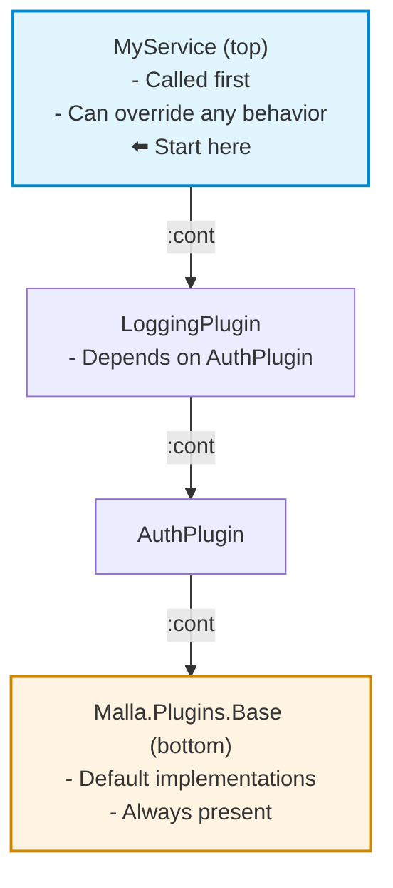

# Plugins

Plugins are the fundamental building blocks for creating reusable and composable behaviors in Malla. They allow you to extend Malla services with custom functionality by implementing callbacks that participate in compile-time callback chains.

In Malla, everything is a plugin:
- Service modules themselves are plugins (the top-level plugin in a chain).
- `Malla.Plugins.Base` is a special plugin that is always at the bottom of the hierarchy.

## Using Plugins

You add plugins to a service using the `:plugins` option in the `use Malla.Service` macro.

```elixir
defmodule MyService do
  use Malla.Service,
    plugins: [Malla.Plugins.Tracer, MyCustomPlugin]
  
  defcb my_callback(arg) do
    # Your service's implementation of the callback
    :cont
  end
end
```

## Creating a Plugin

To create a plugin, you `use Malla.Plugin` in a module. You can then implement lifecycle callbacks and `defcb` callbacks.

```elixir
defmodule MyPlugin do
  use Malla.Plugin,
    plugin_deps: [Malla.Plugins.Tracer]
  
  @impl true
  def plugin_config(_srv_id, config) do
    # Validate or modify the service configuration
    case Keyword.get(config, :my_plugin, []) do
      opts when is_list(opts) -> {:ok, config}
      _ -> {:error, :my_plugin_must_be_a_keyword_list}
    end
  end
  
  @impl true
  def plugin_start(_srv_id, config) do
    # Return child specs for the plugin's own supervisor
    initial = get_in(config, [:my_plugin, :initial])

    children = [
      %{id: :store, start: {Agent, :start_link, [fn -> initial end]}}
    ]
    {:ok, children: children}
  end
  
  # A `defcb` callback that participates in the callback chain
  defcb process_data(data) do
    # Continue the chain with the transformed data
    {:cont, String.upcase(data)}
  end
end
```

`plugin_config/2` and `plugin_start/2` are ordinary functions (not `defcb`) and are not part of any callback chain: Malla calls them in a fixed order on each plugin (see [Lifecycle](06-lifecycle.md)). A complete worked example is in [Plugin Development](13-plugin-development.md).

## Plugin Dependencies and Hierarchy

Plugins can declare dependencies on other plugins, creating a hierarchy that determines the execution order of callbacks.

```elixir
defmodule AuthPlugin do
  use Malla.Plugin
end

defmodule LoggingPlugin do
  use Malla.Plugin,
    plugin_deps: [AuthPlugin] # Depends on AuthPlugin
end

defmodule MyService do
  use Malla.Service,
    plugins: [LoggingPlugin] # AuthPlugin is automatically included
end
```

The `plugin_deps` option establishes a dependency relationship: a plugin sits **above** the plugins it depends on. When a callback is invoked, it walks down the chain from the highest-level plugin (the service) to the lowest-level one (`Malla.Plugins.Base`). Plugins start the other way round: a plugin is started after the plugins it depends on.

For the example above, the callback chain order is:



Execution order: MyService → LoggingPlugin → AuthPlugin → Malla.Plugins.Base

The list is available at run time as `MyService.service().plugin_chain`.

### Order of Independent Plugins

Plugins that do not depend on each other keep the order of `plugins:`: the one
declared first is called first. Each plugin's `plugin_deps` go right below it,
and a dependency shared by several plugins goes below all of them:

```elixir
# PluginA and PluginC declare plugin_deps: [Shared]; PluginB has none
use Malla.Service, plugins: [PluginA, PluginB, PluginC]
# Execution order: MyService → PluginA → PluginB → PluginC → Shared → Malla.Plugins.Base
```

The order is the same on every Elixir/OTP version. When a plugin must be called
before another one, declare it with `plugin_deps` rather than relying on the
order of `plugins:`.

### Optional Dependencies

You can mark a dependency as optional. A missing optional plugin (the module does not exist or is not a plugin) is not an error. An optional dependency only affects the **order**: it is placed below the plugin that declares it if it is part of the service, but it is not added to the service by that declaration alone, even when its module exists. It is part of the service if it is listed in `plugins:` or required by another plugin.

```elixir
use Malla.Plugin,
  plugin_deps: [
    RequiredPlugin,
    {OptionalPlugin, optional: true}
  ]
```

```elixir
# OptionalPlugin exists, but nothing else asks for it: it is NOT in the chain
use Malla.Service, plugins: [MyPlugin]

# Listed in plugins: it is in the chain, below MyPlugin
use Malla.Service, plugins: [MyPlugin, OptionalPlugin]
```

### Plugin Groups

To enforce a specific ordering among a set of related plugins, you can assign them to a `group`. Plugins in the same group are made to depend on the previous plugin in the list, ensuring sequential ordering.

```elixir
# All these plugins belong to the :my_group
defmodule PluginA do; use Malla.Plugin, group: :my_group; end
defmodule PluginB do; use Malla.Plugin, group: :my_group; end
defmodule PluginC do; use Malla.Plugin, group: :my_group; end

defmodule MyService do
  use Malla.Service,
    plugins: [PluginA, PluginB, PluginC]
end
```
This results in the dependency chain `PluginC` → `PluginB` → `PluginA`. The callback execution order will be `MyService` → `PluginC` → `PluginB` → `PluginA`.

In other words, for `plugins: [A, B, C]` in one group the plugins **start** `A → B → C` (each one after the previous one) and their callbacks **run** `C → B → A`: the group is a chain of `plugin_deps` where each plugin depends on the previous one of its group in the list. Plugins of the group are only chained when they are listed in the service's `plugins:` option; a plugin that is in the service only because another plugin depends on it is not chained with its group.

## The Callback Chain

Callbacks defined with `defcb` participate in the plugin chain. When a callback is invoked, execution starts at the top of the hierarchy (the service) and proceeds downwards. Only the modules that define that callback take part in its chain.

Each plugin in the chain can control the flow with its return value:
- **`:cont`**: Continue to the next plugin in the chain with the same arguments.
- **`{:cont, new_args}`** or **`{:cont, arg1, arg2}`**: Continue to the next plugin with new, modified arguments. A list replaces the whole argument list, so a callback that takes a single argument that is itself a list must wrap it: `{:cont, [new_list]}`.
- **Any other value**: Stop the chain and return that value immediately.

If the last implementation of the chain itself returns `:cont` or `{:cont, ...}`, there is nobody to continue to, and that raw value is returned to the caller. See the [Callbacks guide](05-callbacks.md) for a more detailed explanation.

## Runtime Plugin Specification

Plugins are typically declared at compile time via `use Malla.Service, plugins: [...]`. However, you can also specify plugins **at startup** by passing `plugins:` to `start_link/1`:

```elixir
# Service declared with no plugins
defmodule MyService do
  use Malla.Service, global: true
end

# Plugins chosen at runtime
{:ok, pid} = MyService.start_link(plugins: [MyPlugin, AnotherPlugin])
```

When runtime plugins are provided, they **replace** the compile-time plugin list entirely. The plugin chain is rebuilt with full dependency resolution, callback generation, and dispatch module recompilation. The dispatch module is compiled at runtime, so the Elixir compiler must be available in the running system (it is in a standard Mix release).

This is especially useful for:
- **Escript/CLI deployments** where plugin selection comes from config files
- **Testing** different plugin combinations without recompiling
- **Multi-tenant services** that need different plugin sets per instance

Plugins can also be added and removed from already-running services. See [Reconfiguration](07a-reconfiguration.md).

## Lifecycle Callbacks

Plugins can hook into the service lifecycle by implementing standard Elixir behaviours. These are optional; the defaults do nothing (`:ok`).

- `c:Malla.Plugin.plugin_config/2`: Called during the configuration phase (top-down), when the service starts and again on every reconfiguration. Each plugin can validate and modify the service configuration.
- `c:Malla.Plugin.plugin_config_merge/3`: Called when new configuration options need to be merged (during startup with runtime config, or during reconfiguration). The update is deep-merged on top of whatever the plugins return; see [Reconfiguration](07a-reconfiguration.md).
- `c:Malla.Plugin.plugin_start/2`: Called during the start phase (bottom-up). Each plugin can initialize resources and return a list of child processes to be supervised.
- `c:Malla.Plugin.plugin_updated/3`: Called (bottom-up) when a service's configuration is updated at runtime. It can request a restart of that plugin (not of the service) if needed.
- `c:Malla.Plugin.plugin_stop/2`: Called during the stop phase (top-down). Each plugin can clean up its resources before its children are stopped.
- `c:Malla.Plugin.plugin_module/1`: A **compile-time** hook (not runtime). Returns a quoted expression that is spliced into the service module, letting a plugin add functions or submodules parameterized by the service's compile-time data. What it injects is a plain function (or module) of the service module; it is not a callback, so it is not part of a virtual module (see [Service Discovery](08-distribution/02-service-discovery.md)). Use sparingly, and any plugin that uses it must document exactly what it injects into the service module.

See the [Lifecycle guide](06-lifecycle.md) for more details on the complete lifecycle, and the [Reconfiguration guide](07a-reconfiguration.md) for details on runtime configuration updates.
