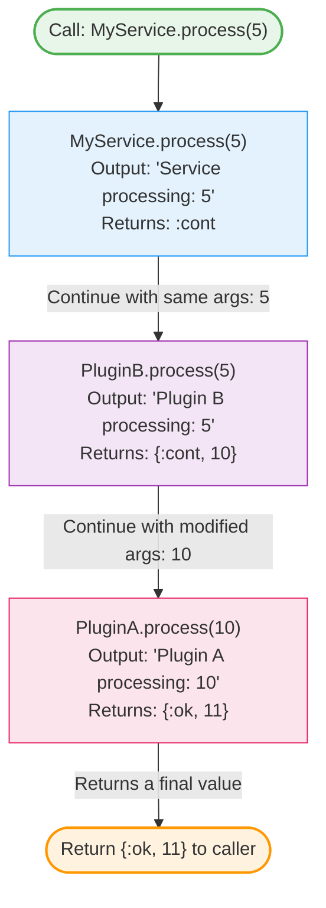

# Callbacks

Callbacks are special functions that participate in Malla's compile-time callback chain, allowing for extensible and composable service behavior. They are the core mechanism through which plugins interact and modify functionality.

## Defining Callbacks

You define a callback using the `defcb` macro instead of the standard `def`.

```elixir
defmodule MyService do
  use Malla.Service

  # This is a regular function and does not participate in the callback chain.
  def regular_function(arg) do
    arg * 2
  end

  # This is a callback and is part of the plugin chain.
  defcb my_callback(arg) do
    # Process the argument
    result = arg + 1

    # Continue the chain, passing the modified result to the next plugin.
    {:cont, result}
  end

  # This callback might stop the chain based on a condition.
  defcb another_callback(arg) do
    if arg == :stop do
      # Stops the chain and returns this value to the original caller.
      {:ok, :stopped}
    else
      # Continues the chain with the same arguments.
      :cont
    end
  end
end
```

In a service, the `defcb` macro renames your implementation (for example to `my_callback_malla_service`) and the module gets a function with the original name that calls a generated dispatch module. The dispatch module walks the chain of plugins that implement the callback. In a plugin, `defcb` defines a normal public function with the name you gave.

The chain is resolved at compile time into direct function calls: with one implementation the call is direct; with two it is a call plus a `case` on the result; with three or more the dispatch module walks a list of modules calling each with `apply/3`. There is no runtime lookup of who implements a callback. Calling a callback from outside the service also sets the service ID in the process dictionary and restores the previous value afterwards. The dispatch module is recompiled when plugins are added to or removed from a running service.

A callback is identified by its name **and arity**: `process/1` and `process/2` are different callbacks with different chains. A `defcb` with a default argument (`defcb f(a, b \\ 1)`) registers only the highest arity, `f/2`; `f/1` is not generated on the service module, so define the lower arity explicitly if you need it.

## Accessing the Service ID

Before Malla invokes a callback on a service, it stores the service's ID in the process dictionary. This allows you to access the current service ID from within your callback implementation using `Malla.get_service_id/0` (or `Malla.get_service_id!/0`, which raises `Malla.ServiceIdMissing` if there is none).

Many functions in the Malla API are context-aware. If you omit the service ID when calling them from within a callback, they use the ID from the process dictionary.

```elixir
defmodule MyService do
  use Malla.Service, plugins: [Malla.Plugins.Tracer]
  use Malla.Tracer

  defcb my_callback(arg) do
    # Retrieve the current service ID
    service_id = Malla.get_service_id!()

    # `info/1` finds the service ID by itself, in the process dictionary.
    info("callback of #{inspect(service_id)} called with #{inspect(arg)}")

    :cont
  end
end
```

Only callbacks set the service ID. A plain function of the service that is called directly (`MyService.regular_function(1)`) runs in the caller's process with whatever service ID the caller has, possibly none. If such a function needs it, set it with `Malla.put_service_id/1`, or call the function with `Malla.local/3`, which sets the service ID for the duration of the call and restores the previous one:

```elixir
Malla.local(MyService, :regular_function, [1])
```

`Malla.local/3` goes through the `service_cb_in/3` callback of the service (see below), so it works for plain functions and for callbacks. `Malla.local/2` does the same using the service ID of the process dictionary.

## Controlling the Chain with Return Values

The value returned by a `defcb` callback determines how the chain proceeds.

#### `:cont` - Continue with Same Arguments
Return `:cont` to signal that the next module in the chain should be called with the exact same arguments.

```elixir
defcb process(data) do
  # Perform a side-effect, like logging.
  IO.puts("Processing data: #{inspect(data)}")

  # Continue the chain.
  :cont
end
```

#### `{:cont, new_args}` - Continue with Modified Arguments
Return a tuple starting with `:cont` to continue the chain but with a new set of arguments. The arguments can be given as a list or as separate elements of the tuple:

```elixir
# A list with the new arguments: it must have one element per argument
defcb transform(data) do
  {:cont, [String.upcase(data)]}
end

# The same, with the arguments as elements of the tuple
defcb split(data1, data2) do
  {:cont, String.upcase(data1), String.upcase(data2)}
end

# A single value that is not a list is the only argument
defcb single(data) do
  {:cont, String.upcase(data)}
end
```

A list is always taken as the **whole argument list**. A callback with a single argument that is itself a list must wrap it, otherwise the next module is called with the elements of the list as separate arguments and fails with `UndefinedFunctionError`:

```elixir
defcb reverse_all(items) do
  # {:cont, Enum.reverse(items)} would call the next module with length(items) arguments
  {:cont, [Enum.reverse(items)]}
end
```

#### Any Other Value - Stop the Chain
Return any value that is not `:cont` or a `{:cont, ...}` tuple to stop the execution of the callback chain immediately. This value will be returned to the original caller.

```elixir
defcb validate(data) do
  if valid?(data) do
    # Data is valid, let the chain continue.
    :cont
  else
    # Data is invalid, stop the chain and return an error.
    {:error, :invalid_data}
  end
end
```

#### What the caller gets when nobody stops the chain
When the **last** module of a chain returns `:cont` or `{:cont, ...}`, there is no next module, and that raw value is returned to the caller. For example, if no implementation of `validate/1` returns a final value, `MyService.validate(data)` returns `:cont`. Make sure the chain ends in a module that returns a real value; `Malla.Plugins.Base` does it for the callbacks it provides (`service_is_ready?/0` returns `true`, for instance), but for your own callbacks the bottom implementation is yours to write.

(The dispatcher also accepts `:continue` and `{:continue, ...}` as continuation values, as the status callbacks of `Malla.Plugins.Status` do. Use `:cont` in new code.)

## A Note on Catch-All Clauses
When implementing a callback, it is good practice to include a "catch-all" clause that returns `:cont`. This makes your callback handle the argument patterns it does not support by passing them on, so other plugins in the chain can process them.

For example:

```elixir
defmodule MyRobustPlugin do
  use Malla.Plugin

  # Specifically handle a 2-tuple
  defcb my_callback({key, value}) do
    # process the tuple
    {:cont, {key, String.upcase(value)}}
  end

  # Catch-all for any other arguments
  defcb my_callback(_args) do
    :cont
  end
end
```

Without the catch-all clause, a call to `my_callback` with an unexpected argument (e.g., `my_callback("some string")`) raises a `FunctionClauseError`. The exception is raised from the plugin and is not caught by the dispatcher; the call fails and other plugins further down the chain are never reached. The catch-all avoids this.

A catch-all only covers other *values* of the same arity. A call with a different number of arguments is a different callback, and if no module defines it the function does not exist.

## How Callback Chains Work

### Execution Flow Diagram



### Example Code

Given the following setup:

```elixir
defmodule PluginA do
  use Malla.Plugin
  
  # The bottom of the chain: it returns a final value
  defcb process(x) do
    IO.puts("Plugin A processing: #{x}")
    {:ok, x + 1}
  end
end

defmodule PluginB do
  use Malla.Plugin,
    plugin_deps: [PluginA] # Depends on PluginA
  
  defcb process(x) do
    IO.puts("Plugin B processing: #{x}")
    {:cont, x * 2}
  end
end

defmodule MyService do
  use Malla.Service,
    plugins: [PluginB] # Depends on PluginB
  
  defcb process(x) do
    IO.puts("Service processing: #{x}")
    :cont
  end
end
```

The dependency hierarchy is `MyService` → `PluginB` → `PluginA`. When you call `MyService.process(5)`, the execution flows from top to bottom:

1.  `MyService.process(5)` is called. It prints "Service processing: 5" and returns `:cont`.
2.  The chain continues to `PluginB.process(5)`. It prints "Plugin B processing: 5" and returns `{:cont, 10}`. The argument for the next module is now `10`.
3.  The chain continues to `PluginA.process(10)`. It prints "Plugin A processing: 10" and returns `{:ok, 11}`, which is not a continuation value.
4.  The chain stops. `{:ok, 11}` is returned to the original caller.

If `PluginA.process/1` had returned `{:cont, 11}` instead, there would be no module left to continue to, and the caller would receive the raw `{:cont, 11}`.

## Callbacks Provided by `Malla.Plugins.Base`

Every service has these callbacks, and you can implement them in your service or your plugins:

| Callback | Purpose | Default |
| :--- | :--- | :--- |
| `service_config/1` | Called on start with the merged configuration, before `plugin_config/2`; return `{:ok, config}` or `{:error, reason}` (it is not documented in the API reference) | `{:ok, config}` |
| `c:Malla.Plugins.Base.service_status_changed/1` | Called on every running-status change. Return `:cont` | `:ok` |
| `c:Malla.Plugins.Base.service_is_ready?/0` | Readiness. Return `:cont` if ready, `false` if not | `true` |
| `c:Malla.Plugins.Base.service_drain/0` | Drain. Return `:cont` if drained, `false` if still working | `true` |
| `c:Malla.Plugins.Base.service_cb_in/3` | Entry point of `Malla.local/3` and of remote calls; by default it applies the function to the service module | `apply(service, fun, args)` |
| `c:Malla.Plugins.Base.malla_authorize/3` | Called by `Malla.authorize/3` | `{:error, :auth_not_implemented}` |

See the [Lifecycle guide](06-lifecycle.md) for the first four. `service_cb_in/3` is the place to instrument every call that arrives through `Malla.remote/4` (and `Malla.local/3`), for instance with a span.

### Authorization

`Malla.authorize/3` calls `malla_authorize/3` on the service of the process (or on the one given in the `:service_id` option). There is no policy built in: the default answers `{:error, :auth_not_implemented}`, so implement the callback in your service or a plugin.

```elixir
defmodule MyService do
  use Malla.Service

  defcb malla_authorize(:orders, :read, _opts), do: true
  defcb malla_authorize(_resource, _scope, _opts), do: {:error, :forbidden}
end

Malla.authorize(:orders, :read, service_id: MyService)
# => true
```

Valid answers are `boolean | {boolean, term} | {:error, term}`.

## Inspecting the Chain of a Callback

`Malla.Service.get_callbacks/2` returns, for a callback name, each arity with the modules that implement it, in the order they are called:

```elixir
iex> Malla.Service.get_callbacks(MyService, :process)
[
  {{:process, 1},
   [{MyService, :process_malla_service}, {PluginB, :process}, {PluginA, :process}]}
]
```

Each entry is `{module, function_name}`; the service module's own implementation is stored under the `_malla_service` name. `MyService.service().plugin_chain` is the list of all the plugins, and `MyService.service().callbacks` has the chain of every callback.

## Next Steps

- [Plugins](04-plugins.md) - Understand how plugins use callbacks to create composable behavior.
- [Services](03-services.md) - See how to use callbacks within the context of a Malla service.
