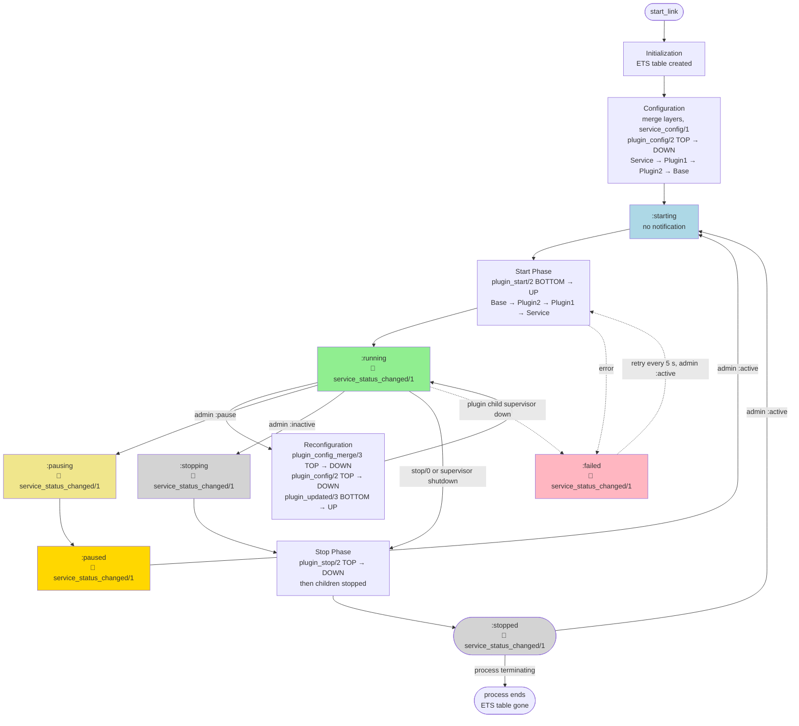

# Service Lifecycle

This guide covers the lifecycle of a Malla service, from startup and configuration to shutdown and error handling.

## Lifecycle States

A Malla service has two independent status dimensions: an **Admin Status** that is controlled by the user/operator, and a **Running Status** that reflects the current operational state of the service.

### Admin Status
This status is set with `Malla.Service.set_admin_status/3` (or `MyService.set_admin_status/2`) to control the desired state of the service.
- `:active` - The service should be running.
- `:pause` - The service is paused. Its plugins and their children stay as they are (a running service keeps its children running), but the service reports `:paused`: it is no longer offered to other nodes (calls through `Malla.remote/4` get `{:error, :malla_service_not_available}`), `Malla.Plugins.Request` answers new requests with `{:error, :malla_service_not_available}`, and `Malla.Service.is_ready?/1` is `false`. Callbacks called locally still run: Malla does not block them.
- `:inactive` - The plugins are stopped (`plugin_stop/2` first, then their children) and the service reports `:stopped`. The service **process stays alive** with its ETS table, and can be started again with `:active`.

A service declared with `paused: true` starts with admin status `:pause`: it goes straight to `:paused` and no plugin is started until you set `:active`.

### Running Status
This status represents the actual state of the service.
- `:starting` - The service is performing its startup sequence.
- `:running` - The plugins are started. Only a `:running` service is listed by `Malla.Node` as available for remote calls.
- `:pausing` - The service is transitioning to the `:paused` state.
- `:paused` - The service is paused.
- `:stopping` - The service is stopping its plugins because of admin status `:inactive`.
- `:stopped` - The plugins have been stopped (by `:inactive`, or because the service process is terminating).
- `:failed` - A plugin could not start, or the supervisor of a plugin's children went down. The service process stays alive and tries to start again (see "Failed services" below).

You can read the running status with `Malla.Service.get_status/1` (or `MyService.get_status/0`); it returns `:unknown` if the service process is not running. More details (including the last error) come from `Malla.Service.get_service_info/2`.

## Lifecycle Sequence

### Visual Overview



### 1. Startup Sequence
When [`MyService.start_link/1`](`c:Malla.Service.Interface.start_link/1`) is called (either directly or by a supervisor):

1.  **Initialization**: An ETS table for service-specific storage is created and the service ID is set in the process dictionary of the service process. If the start options carry `plugins:`, the plugin chain is rebuilt first.
2.  **Configuration Phase**: The configuration layers are merged (static, then `otp_app`, then the runtime options; each layer goes through `c:Malla.Plugin.plugin_config_merge/3`). Then the `service_config/1` callback (see [Callbacks](05-callbacks.md)) is called, and then `c:Malla.Plugin.plugin_config/2` is called for each plugin (top-down: the service module first, then the plugins above their dependencies, ending at `Malla.Plugins.Base`). Each plugin can validate and modify the configuration. An error here, or a configuration with a key that is only allowed in `use Malla.Service`, stops the service: `start_link/1` fails and the process does not start.
3.  The process is now registered and `start_link/1` returns. The running status is `:starting`. This first status is **not** notified through `service_status_changed/1`.
4.  **Start Phase** (Bottom-up): right after, still in the service process, `c:Malla.Plugin.plugin_start/2` is called for each plugin, starting from `Malla.Plugins.Base` and moving up to the service module. A plugin can return child specs; they are started under a supervisor of that plugin, which is linked to the service process.
5.  **Running**: Once all plugins have started, the running status becomes `:running` and `service_status_changed(:running)` is called.

### 2. Reconfiguration
You can update a service's configuration at runtime by calling [`Malla.Service.reconfigure(MyService, new_config)`](`Malla.Service.reconfigure/2`). This process involves these callbacks:

1. **Configuration Merge Phase** (Top-down): `c:Malla.Plugin.plugin_config_merge/3` is called for each plugin, starting from the service module and moving down the dependency chain, and then the update is deep-merged on top of the result.
2. **Configuration Phase** (Top-down): `c:Malla.Plugin.plugin_config/2` is called again for each plugin with the merged configuration. If the service has `otp_app`, its application environment is re-applied first, then your update on top of it.
3. **Update Phase** (Bottom-up): `c:Malla.Plugin.plugin_updated/3` is called for each plugin, starting from the lowest-level dependency and moving up. Each plugin receives the old and new configuration and can optionally ask for **that plugin** to be restarted: its children supervisor is stopped and `plugin_start/2` runs again.

For a comprehensive guide to reconfiguration, including adding and removing plugins, see the [Reconfiguration guide](07a-reconfiguration.md).

### 3. Pause and Resume
- [`Malla.Service.set_admin_status(MyService, :pause)`](`Malla.Service.set_admin_status/3`): The running status goes `:pausing`, then `:paused`. The plugins are not stopped. The service is no longer listed as available to other nodes.
- [`Malla.Service.set_admin_status(MyService, :active)`](`Malla.Service.set_admin_status/3`): The running status goes `:starting` and then `:running`. Plugins that are already started are not started again; plugins that are not started yet (when the service began paused) are started.

### 4. Inactive
[`Malla.Service.set_admin_status(MyService, :inactive)`](`Malla.Service.set_admin_status/3`): `:stopping`, then `plugin_stop/2` of each plugin from the service down to `Malla.Plugins.Base`, each followed by the stop of its children, then `:stopped`. The process stays alive. Use `:active` to start the plugins again.

### 5. Shutdown Sequence
When a service process is stopped (either via [`MyService.stop/0`](`c:Malla.Service.Interface.stop/0`) or by its supervisor):

1.  **Stop Phase** (Top-down): `c:Malla.Plugin.plugin_stop/2` is called for each plugin, from the service down to `Malla.Plugins.Base`. After each one, the supervisor of that plugin's children is stopped. This allows plugins to perform cleanup, release resources, and close connections.
2.  **Final State**: The running status becomes `:stopped` and `service_status_changed(:stopped)` is called. This path goes straight from `:running` to `:stopped`; `:stopping` is only used by admin status `:inactive`.
3.  **ETS Table Destroyed**: The process ends and its ETS table, owned by it, disappears with all its data. This happens after the `:stopped` notification, so the table can still be read from `service_status_changed(:stopped)`.

## Status Change Notifications

Every time the running status changes, the `c:Malla.Plugins.Base.service_status_changed/1` callback is invoked through the callback chain of the service. This allows plugins to react to status changes, such as:

- Opening or closing connections when transitioning to/from `:running`
- Logging status changes for monitoring
- Triggering health check updates
- Coordinating with external systems

It is called with `:running`, `:pausing`, `:paused`, `:stopping`, `:stopped`, `:failed`, and with `:starting` when a service becomes active again from `:paused` or `:stopped`; it is not called for the very first `:starting`. While a service stays in a failing start loop, `:failed` is notified again on every failed attempt. The callback runs inside the service process, so it must not block.

Example implementation in a plugin:

```elixir
defmodule MyPlugin do
  use Malla.Plugin
  require Logger
  
  defcb service_status_changed(status) do
    case status do
      :running ->
        Logger.info("Service is now running")
        # Open connections, start accepting work
      :paused ->
        Logger.info("Service is paused")
        # Stop accepting new work
      :stopped ->
        Logger.info("Service stopped")
      _ ->
        :ok
    end
    
    # Always return :cont to allow other plugins to handle the status change
    :cont
  end
end
```

**Important**: Always return `:cont` from `c:Malla.Plugins.Base.service_status_changed/1` so that the callback chain continues and all plugins receive the notification. The service expects the chain to end with `:ok`, which `Malla.Plugins.Base` returns; a final value that is not `:ok` makes the service process crash.

## Readiness and Health Checks

Malla provides a readiness mechanism to determine if a service is fully operational and ready to accept work. This is particularly useful for:
- Kubernetes readiness probes
- Load balancer health checks
- Coordinated service deployment

### Liveness

`Malla.Service.is_live?/1` is `true` while the status is `:starting`, `:running`, `:pausing`, `:paused`, `:stopping` or `:stopped`, and `false` if the status is `:failed` or `:unknown` (the service process is not running). It is meant for liveness probes: a service that stays `:failed` is reported as not live so that the platform can restart the node.

### Readiness Check

Call `Malla.Service.is_ready?/1` to check if the service is ready. This function:
1. Returns `false` if the running status is not `:running`.
2. If status is `:running`, invokes the `c:Malla.Plugins.Base.service_is_ready?/0` callback chain across all plugins.
3. Returns `true` only if all plugins return `:cont` (meaning they are ready).
4. Returns `false` if any plugin returns `false` (meaning it's not ready).

Example implementation in a plugin:

```elixir
defmodule DatabasePlugin do
  use Malla.Plugin
  
  defcb service_is_ready?() do
    srv_id = Malla.get_service_id!()

    # Check if the database connection pool is established
    case Malla.Service.get(srv_id, :db_pool_ready) do
      true -> :cont   # This plugin is ready, check next plugin
      _ -> false      # Not ready, stop the chain and return false
    end
  end
end
```

**Important**: Plugins should return `:cont` when ready to allow the chain to continue, or `false` to indicate they are not ready. Do not return `true` directly from `service_is_ready?/0`: it would end the chain and the plugins below would not be asked. (`Malla.Plugins.Base` is the end of the chain and returns `true`.)

## Graceful Shutdown and Drain

Malla provides a drain mechanism for graceful shutdowns, allowing services to complete in-flight work before the node is stopped. This is essential for:
- Rolling deployments
- Kubernetes pod termination
- Coordinated cluster updates

### Drain Process

Call `Malla.Service.drain/1` to ask the service to drain. This function:
1. Invokes the `c:Malla.Plugins.Base.service_drain/0` callback chain across all plugins.
2. Each plugin should clean up its state and stop accepting new work.
3. Returns `true` if all plugins return `:cont` (all plugins are fully drained).
4. Returns `false` if any plugin returns `false` (drain not complete, needs retry).

`drain/1` does not change the status of the service and does not stop it; it only asks the plugins. The drain mechanism is typically used in two phases:

1. **Mark service as draining**: Stop accepting new work, but continue processing existing requests
2. **Poll until drained**: Repeatedly call `drain/1` until it returns `true`, then stop the service

Example implementation in a plugin:

```elixir
defmodule WebServerPlugin do
  use Malla.Plugin
  require Logger
  
  defcb service_drain() do
    srv_id = Malla.get_service_id!()
    
    # Check if we have any active connections
    active_connections = Malla.Service.get(srv_id, :active_connections, 0)
    
    case active_connections do
      0 ->
        # No active connections, we're fully drained
        Logger.info("WebServer fully drained")
        :cont
      
      count ->
        # Still have active connections, not ready to stop
        Logger.info("WebServer draining: #{count} active connections remaining")
        false
    end
  end
end
```

### Typical Drain Workflow

Here's a typical graceful shutdown workflow using the drain mechanism:

```elixir
defmodule Shutdown do
  require Logger

  def graceful_stop(service, retries \\ 30) do
    # 1. Mark the service as paused (it is no longer offered to other nodes)
    Malla.Service.set_admin_status(service, :pause)

    # 2. Poll until all in-flight work completes
    case wait_for_drain(service, retries) do
      :ok ->
        # 3. Stop the service
        Malla.Service.stop(service)

      error ->
        error
    end
  end

  defp wait_for_drain(service, retries) do
    case Malla.Service.drain(service) do
      true ->
        Logger.info("Service fully drained")
        :ok

      false when retries > 0 ->
        Logger.info("Waiting for drain, #{retries} retries left")
        Process.sleep(1000)
        wait_for_drain(service, retries - 1)

      false ->
        Logger.warning("Drain timeout")
        {:error, :drain_timeout}
    end
  end
end
```

**Important**: Plugins should return `:cont` when fully drained to allow the chain to continue, or `false` if they still have work to complete. The drain can be called multiple times until all plugins report completion.

### Draining every service of a node

`Malla.Service.drain_all_local/0` drains all the services running on the
node, in the order of their `:priority` option (lowest first, default `0`), and
returns `true` once all of them are drained. It stops at the first service that is
not drained yet, so the ones after it keep working; call it again until it returns
`true`. Give a higher priority to services that must outlive the others, such as
the HTTP server that answers the drain request:

```elixir
defmodule MyHttp do
  use Malla.Service,
    plugins: [Malla.Plugins.Httpd.Lifecycle],
    priority: 1000
end
```

`GET /stop` of `Malla.Plugins.Httpd.Lifecycle` uses it (see
[HTTP Admin Server](11-http-admin.md)).

## Error Handling

### Failed services

A service goes to `:failed` in two cases:

- **A plugin cannot start**: `plugin_start/2` returns `{:error, reason}`, or the supervisor for the children it asked for cannot start. (An exception raised inside `plugin_start/2` is not caught: it crashes the service process, see below.) The service logs it and stops the plugins that **did** start, calling their `plugin_stop/2` from the top (the plugin that failed, and the ones that were still to start, are not stopped), then sets `:failed` (`last_error` holds the reason).
- **A plugin's children go down**: the supervisor that `plugin_start/2` asked for stops (for example because its children exceeded `max_restarts`). The service sets `:failed` with `{:child_failed, plugin}`.

In both cases the service **process stays alive**. Every 5 seconds it checks its state, and while the admin status is `:active` a `:failed` service tries to start the plugins that are not running (all of them after a failed start, only the one that went down in the second case). When that works, the status is `:running` again. With admin status `:pause` or `:inactive` a failed service is not retried.

A service that stays `:failed` is reported by `Malla.Service.is_live?/1` as not live; that is what a liveness probe should use to get the node restarted.

### Crashes of the service process

If the service process itself crashes (an exception in a callback it runs, for instance in `service_status_changed/1`), its terminate hook stops the plugins and the process ends. A supervisor that started it with `child_spec/1` (`restart: :transient`) restarts it, and the whole startup sequence runs again; the ETS table starts empty.

## Compile-Time Code Injection

In addition to the runtime callbacks above, plugins can hook into the **service module's compilation** via `c:Malla.Plugin.plugin_module/1`. This callback runs once when the service module is being compiled (not when the service starts), and its return value — a quoted expression — is spliced into the service module's body.

This is useful when a plugin needs to add functions, attributes, or nested submodules to the service module itself, parameterized by compile-time data such as the service's `id`, the resolved `plugin_chain`, or the registered `callbacks` map.

> **⚠️ Use sparingly.** Code injection makes the service module's surface area depend on which plugins were compiled into it — readers cannot tell from the service source where a given function came from. Prefer ordinary `defcb` callbacks or plain plugin functions whenever they can express the same behavior. Reach for `plugin_module/1` only when the generated code genuinely needs to close over compile-time data or live as a nested submodule under the service.
>
> **Always document what is injected.** Any plugin that implements `plugin_module/1` must state, in its own `@moduledoc`, exactly what it adds to the service module: the names and arities of generated functions, any module attributes, and any nested submodules. Without this, users of the plugin have no way to know which symbols on their service module came from where.

```elixir
defmodule MyApp.MetricsPlugin do
  @moduledoc """
  ...

  ## Injected into the service module

  This plugin uses `c:Malla.Plugin.plugin_module/1` and adds the following
  to the service module:

    * `metric_prefix/0` — returns the metric prefix string for this service.
  """

  use Malla.Plugin

  def plugin_module(service) do
    prefix = "malla." <> Atom.to_string(service.id)

    quote do
      def metric_prefix, do: unquote(prefix)
    end
  end
end
```

After compilation, `MyService.metric_prefix/0` is a regular function defined on the service module. It is a plain `def`, not a callback, so it is **not** part of the virtual module that other nodes generate for the service (virtual modules only contain callbacks); another node can reach it with `Malla.remote(MyService, :metric_prefix, [])`.

`plugin_module/1` is invoked in plugin chain order (top-level plugins first, `Malla.Plugins.Base` last), after the callback dispatch logic has been generated, so the `t:Malla.Service.t/0` it receives has its `callbacks` map fully populated.

## Lifecycle Callbacks Summary

Plugins can implement these callbacks to hook into the service lifecycle.

### Standard Plugin Lifecycle Callbacks

These are standard Elixir behaviours defined in `Malla.Plugin`:

| Callback | Order | Trigger | Purpose |
| :--- | :--- | :--- | :--- |
| `c:Malla.Plugin.plugin_config/2` | Top → Bottom | Startup, every reconfiguration (and `add_plugin/3` with `config:`) | Validate and modify configuration. |
| `c:Malla.Plugin.plugin_config_merge/3` | Top → Bottom | Startup (each layer), every reconfiguration | Custom merge logic for configuration updates. |
| `c:Malla.Plugin.plugin_start/2` | Bottom → Top | Startup, resume from `:pause`/`:inactive`, retry after `:failed`, plugin added at runtime, plugin restart | Return child specs to be supervised. |
| `c:Malla.Plugin.plugin_updated/3` | Bottom → Top | Reconfiguration | Handle dynamic configuration changes, optionally request a restart of the plugin. |
| `c:Malla.Plugin.plugin_stop/2` | Top → Bottom | `:inactive`, shutdown, failed start (plugins that started), plugin removed | Clean up resources before the plugin's children are stopped. |
| `c:Malla.Plugin.plugin_module/1` | Top → Bottom | Service compilation | Inject code (functions, attributes, submodules) into the service module. |

### Malla Callbacks (defcb)

These callbacks are defined with `defcb` and participate in the callback chain:

| Callback | Chain Order | Trigger | Purpose |
| :--- | :--- | :--- | :--- |
| `c:Malla.Plugins.Base.service_status_changed/1` | Top → Bottom | Status changes | React to running status changes. Always return `:cont`. |
| `c:Malla.Plugins.Base.service_is_ready?/0` | Top → Bottom | `Malla.Service.is_ready?/1` | Check if service is ready to accept work. Return `:cont` if ready, `false` if not. Used for health checks. |
| `c:Malla.Plugins.Base.service_drain/0` | Top → Bottom | `Malla.Service.drain/1` | Prepare for graceful shutdown. Return `:cont` when fully drained, `false` if still has work. Can be retried. |

## Next Steps

- [Services](03-services.md) - Review the fundamentals of Malla services.
- [Plugins](04-plugins.md) - Understand how plugins define and use these lifecycle hooks.
- [Configuration](07-configuration.md) - Learn more about how configuration is handled during the lifecycle.
- [Reconfiguration](07a-reconfiguration.md) - Deep dive into runtime configuration updates and dynamic plugin management.
